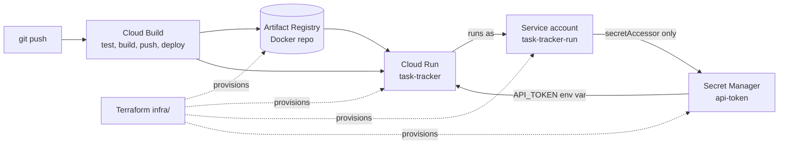

# gcp-cloud-run-cicd

A production-pattern **Cloud Run** service with the full delivery pipeline around it:
a Spring Boot 3 (Java 21) REST API, a multi-stage Dockerfile, a **Cloud Build**
pipeline (test → build → push to Artifact Registry → deploy), and **Terraform**
that provisions the platform (Cloud Run, Artifact Registry, a dedicated runtime
service account, and Secret Manager wiring).

The app itself is a small task tracker — deliberately simple. The point of the
repo is everything *around* the app, because that is where production systems
actually fail: image hygiene, least-privilege identity, secret handling,
health probes, and a pipeline that can never deploy code whose tests failed.

## Architecture



Key decisions, and why:

- **Tests run twice, on purpose.** Cloud Build runs `mvn test`, and the
  Dockerfile runs `mvn verify` in its build stage — an image that contains a
  failing test cannot exist, no matter how it was built.
- **The service runs as its own service account** with exactly one permission
  beyond the platform defaults: `secretmanager.secretAccessor` on one secret.
  No keys in the image, no keys in env files.
- **Secrets arrive as env vars via Secret Manager references**
  (`--set-secrets` in Cloud Build, `secret_key_ref` in Terraform), so the app
  code reads a plain `API_TOKEN` and stays environment-agnostic.
- **Actuator health drives the probes.** Terraform wires Cloud Run's startup
  and liveness probes to `/actuator/health`; `application.properties` exposes
  only `health` and `info`.
- **Multi-stage, non-root container.** Build stage on JDK 21, runtime on a
  slim Alpine JRE, unprivileged `app` user, `PORT` honoured from the
  environment exactly as Cloud Run injects it.

## API

| Method | Path | Description |
|---|---|---|
| GET | `/api/` | Service banner / smoke check |
| POST | `/api/tasks` | Create a task (`{"title": "..."}`, validated) |
| GET | `/api/tasks` | List tasks |
| GET | `/api/tasks/{id}` | Get one task |
| PATCH | `/api/tasks/{id}/status` | Set status (`TODO` / `IN_PROGRESS` / `DONE`) |
| DELETE | `/api/tasks/{id}` | Delete a task |
| GET | `/actuator/health` | Health probe endpoint |

Errors return a uniform body: `{timestamp, status, error, message}`.
The store is in-memory and thread-safe; swapping it for Cloud SQL or
Firestore means implementing the same `TaskService` surface.

## Run it locally

```bash
mvn spring-boot:run          # http://localhost:8080
curl -X POST localhost:8080/api/tasks -H 'Content-Type: application/json' \
  -d '{"title":"Ship it"}'

mvn test                     # 15 tests: service unit tests + MockMvc web tests
docker build -t task-tracker . && docker run -p 8080:8080 task-tracker
```

## Deploy walkthrough

Nothing in this repo is deployed automatically — run these steps in your own
project (replace `your-gcp-project`):

```bash
# 1. Provision the platform (Artifact Registry, service account, secret, service)
cd infra
cp terraform.tfvars.example terraform.tfvars   # set project_id
terraform init
terraform apply

# 2. Rotate the placeholder secret before real use
echo -n "your-real-token" | gcloud secrets versions add api-token --data-file=-

# 3. Build + deploy through Cloud Build
gcloud builds submit --config cloudbuild.yaml \
  --substitutions _REGION=us-central1,_SERVICE=task-tracker,_REPO=apps
```

Or attach a Cloud Build **GitHub trigger** on push to `main` and step 3 happens
per commit. The runtime service account and secret are Terraform-owned;
Cloud Build only rolls out new revisions, which keeps drift visible in
`terraform plan`.

## CI

`.github/workflows/ci.yml` runs on every push/PR: `mvn verify`, a Docker
image build (no push), and `terraform fmt -check` + `terraform validate`
(no credentials required).

## Layout

```
src/            Spring Boot app (model / service / web) + tests
Dockerfile      multi-stage build, non-root runtime
cloudbuild.yaml test -> build -> push -> deploy
infra/          Terraform: APIs, Artifact Registry, SA, Secret Manager, Cloud Run v2
```
